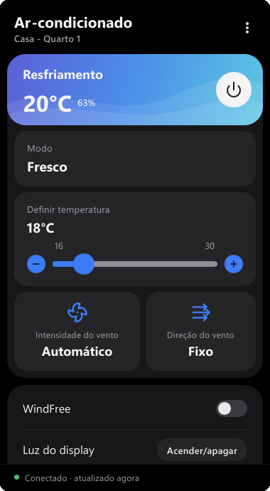
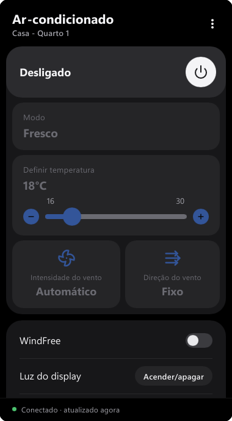

<div align="center">

# ❄️ Controle do Ar

Controle remoto do ar-condicionado **Samsung** na bandeja do Windows, usando a API oficial da **SmartThings**. Um clique no ícone e o controle aparece ao lado dele, mais rápido que pegar o celular.




<br>
<sub>O controle com o ar ligado e desligado</sub>
<br><br>

[](#como-compilar)

</div>

## Funcionalidades

- **Ícone na bandeja com a temperatura alvo**, na cor do modo (azul no resfriamento, laranja no aquecimento etc.) e legível mesmo em 16 px
- **Clique esquerdo:** abre um controle no estilo do app SmartThings, com ligar, modo, temperatura, intensidade e direção do vento, WindFree, Silencioso e Máx. (rápido)
- **Clique direito:** menu rápido com ligar, temperatura ±, modo, modo noite e luz do display
- **Luz do display:** acende e apaga a luz que o app oficial esconde em alguns modelos. Vira um interruptor quando o modelo informa o estado da luz, e um botão quando não informa
- **Modo noite:** apaga a luz, silencia o bipe e liga o WindFree num clique só
- **Se adapta a cada modelo:** modos, velocidades, faixa e unidade de temperatura (°C ou °F) vêm do próprio aparelho, e o que o modelo não tem fica escondido
- **Vários aparelhos:** se a conta tiver mais de um ar, você escolhe qual controlar nas configurações
- **Resposta imediata:** a mudança aparece na hora e é desfeita se a nuvem recusar. O estado atualiza a cada minuto, e o app espera sozinho quando bate no limite de requisições da API
- **Português ou inglês**, conforme o idioma do Windows
- **Leve de verdade:** interface nativa em [Slint](https://slint.dev), sem WebView nem Electron. Cerca de 5 MB de memória com o controle fechado e 6 MB com ele aberto, num processo só

## Como funciona

O app conversa com a `api.smartthings.com` usando a sua conta SmartThings. O login é feito por OAuth no seu navegador (funciona com conta Google) e volta sozinho para o app por uma [página-ponte](docs/callback.html) no GitHub Pages. Os tokens ficam no **Gerenciador de Credenciais do Windows** e são renovados automaticamente. Também dá para entrar com um token pessoal (PAT).

A interface é desenhada em [Slint](https://slint.dev) com renderização por software, sem placa de vídeo nem navegador embutido. O ícone da bandeja é desenhado pelo próprio app no tamanho exato que o Windows usa.

Tudo o que o controle mostra vem do status do aparelho (`supportedAcModes`, `supportedAcFanModes`, faixa do setpoint, `custom.disabledCapabilities` etc.). Para a luz do display e o bipe, o app usa a capability do próprio modelo quando ela está ativa e, quando não está, o comando OCF `execute`, o mesmo que o app da Samsung usa. As descobertas sobre a API, incluindo algumas surpresas, estão em [docs/API-NOTES.md](docs/API-NOTES.md).

Testado num Samsung WindFree 2024 (`DA-AC-RAC-01001`). Outros modelos Samsung que expõem as capabilities padrão de ar-condicionado da SmartThings devem funcionar. Se testar no seu, conte como foi.

## Como compilar

Não há instaladores prontos para baixar: o app OAuth carrega um client secret, então cada pessoa compila com o seu.

**Requisitos:** Windows 10 ou 11, [Rust](https://rustup.rs) 1.92 ou mais novo e, para gerar o instalador, o [NSIS](https://nsis.sourceforge.io) (`winget install NSIS.NSIS`).

### 1. Crie o seu app OAuth na SmartThings (só uma vez)

Instale a [SmartThings CLI](https://github.com/SmartThingsCommunity/smartthings-cli) (pelo instalador das releases dela ou, se tiver o Node.js, com o npm):

```bash
npm install -g @smartthings/cli
```

Abra o [`docs/smartthings-app.json`](docs/smartthings-app.json), troque o `appName` por um nome único e crie o app:

```bash
smartthings apps:create -i docs/smartthings-app.json
```

A CLI abre o navegador para você entrar na conta e mostra um **OAuth Client Id** e um **Client Secret**. Copie o `.env.example` para `.env` e preencha os dois valores. O `.env` é ignorado pelo Git e deve continuar assim.

> [!NOTE]
> **Por que existe uma página-ponte:** a SmartThings recusa redirecionamentos para `http://localhost` e só aceita endereços HTTPS. O app então escuta numa porta livre do próprio PC, coloca o número dela no início do `state` do login, e a SmartThings devolve o login para [`docs/callback.html`](docs/callback.html), que só repassa o código para `127.0.0.1` nessa porta. O app confere o `state` inteiro antes de usar o código.
>
> O modelo já cadastra a ponte deste repositório, que funciona para qualquer um. Se preferir a sua, publique o `docs/` do seu fork no GitHub Pages, cadastre o endereço no app OAuth e coloque `ARCOND_REDIRECT_URI` no `.env`. O `https://httpbin.org/get` fica cadastrado como plano B: nesse modo a página só mostra o código para você colar no app.

Também dá para pular este passo: sem o app OAuth, o login pede um [token pessoal (PAT)](https://account.smartthings.com/tokens), que expira em 24 horas.

### 2. Rode ou gere o instalador

```bash
cargo run                                                  # desenvolvimento
powershell -ExecutionPolicy Bypass -File installeruild.ps1   # instalador em dist/
```

O instalador é por usuário (não pede administrador) e substitui a versão 1 sem deixar sobras. Ao desinstalar, ele também apaga o login guardado e a configuração. Ele não tem assinatura digital, então o SmartScreen do Windows avisa na primeira vez.

> [!WARNING]
> **Não publique instaladores gerados com o seu client secret.** Qualquer pessoa conseguiria extraí-lo do executável. Sozinho ele não dá acesso a nenhuma conta, mas deixa outras pessoas usarem a cota de instalações do seu app OAuth.

### Para desenvolver

- **Testes:** `cargo test`. Incluem o status real de um aparelho, sem identificadores, em `tests/fixtures`.
- **Interface:** os arquivos `.slint` ficam em `ui/`. A [extensão do Slint para o VS Code](https://marketplace.visualstudio.com/items?itemName=Slint.slint) mostra uma prévia ao vivo enquanto você edita.
- **Abrir o controle ao iniciar:** no build de desenvolvimento, `ARCOND_OPEN=1 cargo run` já abre o popup, sem precisar clicar na bandeja.

## Limitações

- Em alguns modelos a API não informa o estado da luz do display e do bipe, então eles aparecem como botões (como o "Acender/apagar" da luz), não como interruptores.
- Só funciona no Windows: a bandeja, o Gerenciador de Credenciais e o posicionamento da janela são específicos dele.

## Estrutura

```
ControleDoAr/
├── src/
│   ├── main.rs             # início: uma cópia só, runtime e interface
│   ├── ui.rs               # liga a interface ao estado: desenha e transforma cliques em ações
│   ├── window.rs           # posiciona o controle ao lado da bandeja e esconde ao perder o foco
│   ├── device.rs           # o que cada modelo suporta, lido do status
│   ├── state.rs            # estado do aparelho e as ações que viram comandos da API
│   ├── core.rs             # estado compartilhado entre a interface e a rede
│   ├── sync.rs             # atualização do status, comandos imediatos e limite de requisições
│   ├── session.rs          # OAuth (com renovação) e PAT
│   ├── login.rs            # login pelo navegador com volta pela página-ponte
│   ├── auth.rs, api.rs     # clientes OAuth e REST da SmartThings
│   ├── secrets.rs          # Gerenciador de Credenciais do Windows
│   ├── winutil.rs          # APIs do Windows (uma cópia só, tela, iniciar com o Windows)
│   └── icon.rs             # desenha a temperatura no ícone da bandeja
├── ui/                     # interface em Slint e ícones
├── installer/              # script do instalador (NSIS) e build.ps1
├── tests/fixtures/         # status real de um aparelho, para os testes
├── docs/                   # notas da API, página-ponte do login, modelo do app OAuth e prints
├── .env.example            # modelo do .env com as credenciais do app OAuth
├── LICENSE
└── README.md
```

## Créditos

Não é afiliado à Samsung. SmartThings é uma marca da Samsung Electronics.

Interface feita com [Slint](https://slint.dev) (#MadeWithSlint), sob a licença [Royalty-free](https://slint.dev/terms-and-conditions), que pede o crédito mostrado na tela "Sobre" do app. Ícones baseados no [Lucide](https://lucide.dev) (licença ISC). Desenvolvido com o auxílio do [Claude](https://claude.ai) (Anthropic).

## Licença

[MIT](LICENSE): use, modifique e distribua à vontade.

<div align="center">
<sub>Feito por <a href="https://github.com/erickfuzer">Erick Fuzer</a></sub>
</div>
