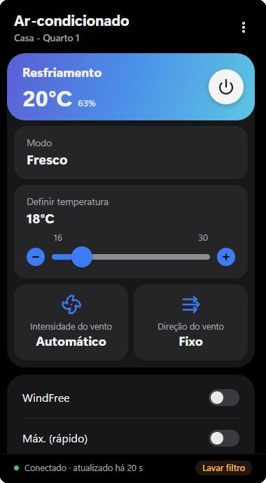
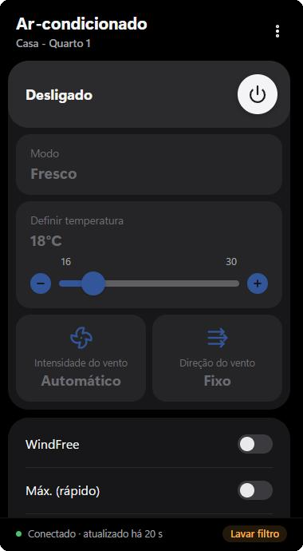

# Controle do Ar

A Windows tray remote for Samsung air conditioners, using the official SmartThings API.
Click the tray icon and a small remote pops up next to it — faster than reaching for your phone.

[Português](#português) · [How it works](#how-it-works) · [Build it yourself](#build-it-yourself)

<p align="center">
  
  
</p>

## Features

- **Tray icon with the target temperature**, colored by mode (blue cooling, orange heating…), readable at 16 px.
- **Left click:** a remote in the style of the SmartThings app — power, mode, temperature, fan speed and direction, WindFree, Quiet, Max (fast).
- **Right click:** quick menu — power, temperature ±, mode, night mode, display light on/off.
- **Display light** on/off, which the official app hides on some models (a real switch when the model reports the light state, a toggle button when it doesn't), and **night mode** (light off + beep muted + WindFree) in one click.
- **Adapts to each model:** modes, fan speeds, temperature range and unit (°C/°F) come from the device itself. Features a model doesn't have are not shown.
- **More than one air conditioner?** Pick which one to control in Settings.
- Optimistic UI (changes show instantly and are reverted if the cloud rejects them), status refresh every minute, automatic backoff when the API rate limit is hit.
- Portuguese and English, following the Windows language.
- Light: a few MB of Rust plus the system WebView2. No Electron.

## How it works

The app talks to `api.smartthings.com` with your SmartThings account. Signing in uses OAuth in a window of the app itself (private, nothing is kept after it closes); the tokens are stored in the **Windows Credential Manager** and renewed automatically. A Personal Access Token also works.

Everything the remote shows is derived from the device status (`supportedAcModes`, `supportedAcFanModes`, setpoint range, `custom.disabledCapabilities`…). For the display light and the beep, the app uses the model's own capability when it is enabled, and falls back to the OCF `execute` command used by Samsung's app when it is not. Notes about the API, including a few surprises, are in [docs/API-NOTES.md](docs/API-NOTES.md).

Tested on a 2024 Samsung WindFree (`DA-AC-RAC-01001`). Other Samsung models that expose the standard SmartThings air conditioner capabilities should work; reports are welcome.

## Build it yourself

There are no prebuilt installers: OAuth apps carry a client secret, so each person builds with their own.

**Requirements:** Windows 10 or 11, [Rust](https://rustup.rs), [Node.js](https://nodejs.org) 20+, and the WebView2 runtime (already present on Windows 11).

### 1. Create your SmartThings OAuth app (once)

```bash
npm install -g @smartthings/cli
```

Edit [`docs/smartthings-app.json`](docs/smartthings-app.json) and give `appName` a unique value, then:

```bash
smartthings apps:create -i docs/smartthings-app.json
```

The CLI opens your browser to sign in and prints an **OAuth Client Id** and **Client Secret**. Copy `.env.example` to `.env` and fill them in. `.env` is ignored by Git — keep it that way.

> The redirect URI is `https://httpbin.org/get` on purpose: SmartThings rejects `http://localhost` redirects. The app intercepts the redirect inside its login window, so the authorization code never reaches httpbin. When signing in through the browser (needed for Google sign-in), the page just shows the code for you to paste back.

Skipping this step is fine too: the app then asks for a [Personal Access Token](https://account.smartthings.com/tokens) instead (it expires after 24 hours).

### 2. Run or build

```bash
npm install
npm run dev     # development, with hot reload of the UI
npm run build   # installer at src-tauri/target/release/bundle/nsis/
```

The installer is per-user (no admin) and downloads WebView2 if the PC doesn't have it. It is not code-signed, so Windows SmartScreen will warn the first time.

**Don't publish installers built with your client secret** — anyone could extract it from the executable. It can't access anyone's account by itself, but it lets others use your OAuth app's installation quota.

## Project layout

```
src/                 popup UI (HTML/CSS/JS, no framework, no bundler)
  dev-mock.js        fake backend to work on the UI in a normal browser (not used by the app)
src-tauri/src/
  device.rs          what each model supports, read from its status
  state.rs           device state and the actions that become API commands
  sync.rs            status polling, optimistic commands, rate limiting
  session.rs         OAuth (with refresh) and PAT, login window
  auth.rs, api.rs    SmartThings OAuth and REST clients
  secrets.rs         Windows Credential Manager
  tray.rs, popup.rs  tray icon/menu and the popup window
  icon.rs            draws the temperature on the tray icon
docs/                API notes and the OAuth app template
```

Tests: `cargo test --manifest-path src-tauri/Cargo.toml` (includes a sanitized real device status in `src-tauri/tests/fixtures`).

To work on the UI without the app, serve `src/` with any static server and open `index.html`. Add `?off`, `?simple` (a °F model without fan/WindFree) or `?login` to the URL to see other states.

## Limitations

- The display light and beep state can't be read through the API on some models, so they are buttons ("turn off" / "turn on"), not switches.
- Google sign-in doesn't work inside embedded windows; use the "sign in with the browser" option.
- Windows only (tray, Credential Manager and window placement are Windows-specific).

## Credits and license

Not affiliated with Samsung. SmartThings is a trademark of Samsung Electronics.
Icons based on [Lucide](https://lucide.dev) (ISC). Code under the [MIT License](LICENSE).

---

## Português

Controle remoto do ar-condicionado Samsung na bandeja do Windows, usando a API oficial da SmartThings.

- **Ícone na bandeja** com a temperatura alvo, na cor do modo.
- **Clique esquerdo:** um controle no estilo do app SmartThings: ligar, modo, temperatura, intensidade e direção do vento, WindFree, Silencioso e Máx. (rápido).
- **Clique direito:** menu rápido com ligar, temperatura ±, modo, modo noite e acender/apagar a luz do display.
- **Luz do display** e **modo noite** (luz apagada, bipe mudo e WindFree) num clique.
- **Se adapta a cada modelo:** modos, velocidades, faixa e unidade de temperatura vêm do próprio aparelho. Dá para escolher entre vários ares da conta.
- Login OAuth numa janela do próprio app (anônima). Os tokens ficam no **Gerenciador de Credenciais do Windows** e são renovados sozinhos.
- Interface em português ou inglês, conforme o idioma do Windows.

**Para compilar:** siga a seção [Build it yourself](#build-it-yourself). Crie o seu app OAuth com a SmartThings CLI usando `docs/smartthings-app.json` (troque o `appName`), copie `.env.example` para `.env` com o Client ID e o Client Secret, e rode `npm install` e `npm run build`. Sem o app OAuth, o login aceita um token pessoal (PAT), que expira em 24h.

Não publique instaladores gerados com o seu client secret: ele pode ser extraído do executável.
